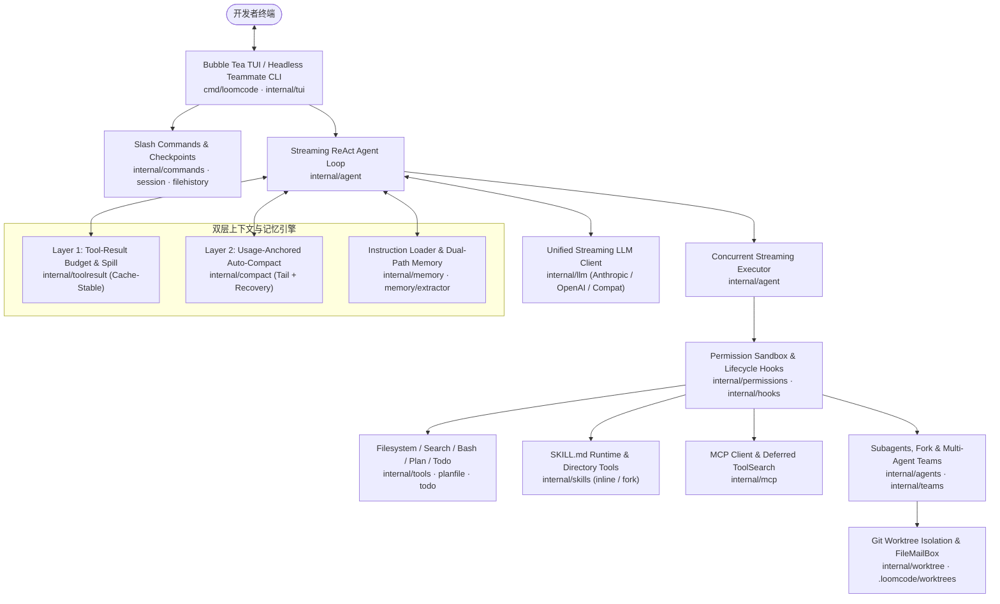

# LoomCode

[](https://github.com/Starchaser1024/LoomCode/actions/workflows/ci.yml)

**LoomCode** 是一个基于 Go 构建的终端原生多智能体编程助手（**Multi-Agent Terminal Coding Harness**）。

它将流式 ReAct 智能体循环、Prompt-Cache 友好的双层上下文管理、Git Worktree 隔离的多智能体团队协作（Coordinator / Teammates）、双路径分层长期记忆、渐进式披露的 `SKILL.md` 运行时，以及 MCP 客户端与声明式生命周期 Hooks 整合进一个零外部运行时依赖的原生的终端交互界面（Bubble Tea TUI）。

---

## 核心工程特性

- **流式 ReAct 循环与并发工具调度（Streaming Execution）**
  - 统一封装 Anthropic Messages API、OpenAI Responses API 与 OpenAI-Compatible 流式协议，支持 Adaptive Thinking 推理块签名保留。
  - 在模型 SSE 流式输出 `tool_use` 完成的瞬间即通过 `StreamingExecutor` 异步并发启动工具执行，无需等待整轮流结束后再串行调度；内置 `max_tokens` 自动提额续写与 `429` 退避重试。
- **Prompt-Cache 稳定的双层上下文管理（Two-Layer Context Architecture）**
  - **Layer 1 — 工具结果预算（`internal/toolresult`）**：对单条超大输出落盘（Spill to `.loomcode/tool_results`）、单消息聚合超限裁剪与陈旧输出截断（Snip）。所有替换决策冻结在 `ContentReplacementState` 中且永不原地篡改原始历史，保证跨轮次 API 请求前缀字节级一致（Byte-Identical Prefix Stability），最大化命中 Prompt Cache。
  - **Layer 2 — 增量锚点压缩与现场恢复（`internal/compact`）**：基于真实 API Usage 锚点（`UsageAnchor`）与新增消息增量估算触发自动摘要压缩，完整保留近期消息尾部及 `tool_use ↔ tool_result` 配对边界，自动注入最近读取的文件快照与已激活的 Skill SOP，并在 JSONL 会话日志中写入 `compact_boundary` 以支持压缩态恢复。
- **多智能体团队与 Git Worktree 隔离（Multi-Agent Teams & Worktree Isolation）**
  - 支持主从协调模式（**Lead Coordinator + Teammates**）：当存在活跃团队时，Lead 自动收敛为纯调度工具集，Teammates 可运行于进程内协程（`in-process`）、`tmux` 分屏或 `iTerm2` 标签页，通过原子写 + 文件锁实现的 `FileMailBox` 异步投递任务与空闲通知。
  - 原生管理 `.loomcode/worktrees/` 隔离工作树，直接解析 `.git` 元数据（`HEAD`、`packed-refs`、`commondir`）实现毫秒级无子进程快速挂载；任务结束若无代码改动自动清理分支与目录，若有未提交改动则安全保留供审查合并。
  - 支持字节级精确的会话分叉（**Conversation Forking**），完整继承父级 Thinking 块与工具替换状态以共享缓存前缀，并内置 `QuerySource` + 历史标记双层防递归分叉保护。
- **分层指令体系与后台自动记忆提炼（Hierarchical Memory & Auto-Extractor）**
  - 按优先级自动发现并合并 `~/.loomcode/` 全局规则、Git 根目录至当前工作目录路径上的 `LOOMCODE.md`（兼容 `CLAUDE.md` / `AGENTS.md`）以及本地私有 `LOOMCODE.local.md`，支持防环 `@./path` 模块化引用展开。
  - 双路径四分类记忆模型：跨项目跟随用户的 `user` / `feedback`（`~/.loomcode/memory/`）与随仓库共享的 `project` / `reference`（`.loomcode/memory/`）。每轮结束后后台异步触发 `extractor` 提炼关键上下文，并在新请求发起时并行预取 Top-5 相关记忆及新鲜度提示。
- **渐进式披露 `SKILL.md` 运行时（Progressive-Disclosure Skills）**
  - 三级目录覆盖（内置 `commit` / `test` / `review` → 用户级 `~/.loomcode/skills` → 项目级 `.loomcode/skills`）。启动阶段仅加载 YAML Frontmatter 生成轻量索引，调用 `/skill` 或 `LoadSkill` 时热加载完整 SOP 并钉住到环境上下文。
  - 支持 `inline`（主循环挂载 + `allowed_tools` 工具白名单收敛）与 `fork`（独立子智能体隔离执行）两种模式，支持 `tool.json` 目录级编译工具动态注入（如内置 `review` 技能挂载的 `diff_summary` 变更风险分析器），并支持通过 `InstallSkill` 从 `skills.sh` 或 GitHub 原子化拉取安装。
- **纵深权限网关、MCP 延迟加载与生命周期 Hooks**
  - **权限沙箱（`internal/permissions`）**：工作区路径越界拦截（`PathSandbox`）、高危 Shell 命令识别、四档权限模式（`default` / `acceptEdits` / `plan` / `bypassPermissions`，支持 `Shift+Tab` 一键切换）与本地持久化授权规则。
  - **MCP 客户端（`internal/mcp`）**：支持 `stdio`、Streamable HTTP 与 SSE 传输；MCP 工具默认标记为 `DeferrableTool`，仅向模型暴露工具名列表，由模型通过 `ToolSearch` 按需装载 JSON Schema，避免数十个外部工具定义挤占上下文窗口。
  - **声明式 Hooks（`internal/hooks`）**：支持在 `pre_tool_use`、`post_tool_use`、`session_start`、`turn_end` 等节点按条件表达式（`==`、`!=`、`=~`、`=*`）执行 `command`、`http`、`prompt` 或 `agent` 动作，支持前置阻断（`reject: true`）与异步非阻塞执行。

---

## 系统架构



---

## 目录与包结构

| 路径 | 职责说明 |
| :--- | :--- |
| `cmd/loomcode` | CLI 入口：默认启动交互式 TUI；传入 `--teammate` 时作为无头 Teammate Worker 进程接入共享邮箱循环 |
| `internal/agent` | 核心流式 ReAct 循环、并发工具执行器（`StreamingExecutor`）、流式错误恢复与单工具执行管线 |
| `internal/agents` | `Agent` 工具实现：角色化子智能体（`explore` / `plan` / `general-purpose` / `verification`）、会话 Fork 与后台任务管理 |
| `internal/teams` | 多智能体团队编排：Coordinator 工具收敛、`FileMailBox` 文件锁邮箱、`in-process` / `tmux` / `iTerm2` 后端生命周期 |
| `internal/worktree` | Git Worktree 隔离管理：零子进程 `.git` 元数据读取、嵌套 Slug 扁平化、会话恢复与陈旧工作树后台清理 |
| `internal/compact` | Layer 2 上下文管理：基于真实 Token 用量锚点的自动摘要压缩、近期尾部保留与工作现场恢复（`RecoveryState`） |
| `internal/toolresult` | Layer 1 工具输出预算：超长输出落盘、聚合超限控制与跨轮次冻结的 `ContentReplacementState` |
| `internal/memory` | 多层 `LOOMCODE.md` 指令发现（含 `@include` 展开）、双路径自动记忆存储、侧路相关性检索与后台 `extractor` 子包 |
| `internal/skills` | 三层 `SKILL.md` 目录、两阶段热加载、`inline`/`fork` 执行器、`tool.json` 编译工具（含 `diff_summary`）与远程安装器 |
| `internal/permissions` | 工作目录沙箱（`PathSandbox`）、高危命令检测、四档权限模式矩阵与本地规则持久化引擎 |
| `internal/mcp` | Model Context Protocol 客户端实现（`stdio` / Streamable HTTP / SSE）与延迟 Schema 加载包装器 |
| `internal/hooks` | 生命周期事件引擎：条件 DSL 解析器与 `command` / `http` / `prompt` / `agent` 四种动作执行器 |
| `internal/llm` | 多模型流式客户端抽象（Anthropic、OpenAI Responses、OpenAI-Compatible）、模型别名解析与上下文窗口探测 |
| `internal/tools` | 基础工具注册表、Read-Before-Edit 文件状态缓存（`FileStateCache`）、`ReadFile` / `EditFile` / `WriteFile` / `Bash` / `Glob` / `Grep` / `ToolSearch` / `AskUserQuestion` |
| `internal/commands` | 内置斜杠命令注册表与 `~/.loomcode/commands`、`.loomcode/commands` Markdown 自定义命令加载器 |
| `internal/session` | `.loomcode/sessions/*.jsonl` 会话持久化、相对时间检索与 `compact_boundary` 压缩边界重建 |
| `internal/filehistory` | 基于内容哈希的逐轮编辑前快照备份与 `/rewind` 代码及对话双向回滚 |
| `internal/tui` | 模块化 Bubble Tea 终端界面：流式渲染、Markdown 高亮、`@` 文件补全、`/` 命令菜单、权限/计划审批弹窗与团队状态树 |

---

## 快速开始

### 环境要求

- **Go** `1.25+`
- **Git**（用于 Worktree 隔离、分支感知与内置 `commit` / `review` 技能）

### 安装与构建

```bash
# 直接安装到 $GOPATH/bin
go install github.com/Starchaser1024/LoomCode/cmd/loomcode@latest

# 或克隆仓库本地构建
git clone https://github.com/Starchaser1024/LoomCode.git
cd LoomCode
go build -o loomcode ./cmd/loomcode
```

### 配置说明

LoomCode 按以下顺序分层加载并合并配置（后者覆盖前者）：
1. `~/.loomcode/config.yaml`（用户全局配置）
2. `<project>/.loomcode/config.yaml`（项目共享配置）
3. `<project>/.loomcode/config.local.yaml`（本地私有覆盖，建议加入 `.gitignore`）

最小化配置示例（`~/.loomcode/config.yaml`）：

```yaml
permission_mode: default

providers:
  - name: Anthropic Claude
    protocol: anthropic
    base_url: https://api.anthropic.com
    model: claude-sonnet-4-6-20250514
    thinking: true
    # api_key 可省略，默认读取环境变量 ANTHROPIC_API_KEY

  - name: OpenAI GPT-4.1
    protocol: openai
    base_url: https://api.openai.com/v1
    model: gpt-4.1
    # 默认读取环境变量 OPENAI_API_KEY

  - name: Compatible Endpoint
    protocol: openai-compat
    base_url: https://api.deepseek.com/v1
    model: deepseek-chat
    # 默认读取环境变量 OPENAI_API_KEY

mcp_servers:
  - name: filesystem
    command: npx
    args: ["-y", "@modelcontextprotocol/server-filesystem", "."]

hooks:
  - id: block-destructive-git
    event: pre_tool_use
    condition: 'tool == "Bash" && args.command =~ /git push --force/'
    reject: true
    action:
      type: prompt
      message: "Force push is blocked by project hook policy."
```

导出对应的 API Key 后即可在任意代码仓库启动：

```bash
export ANTHROPIC_API_KEY="sk-ant-..."
loomcode
```

---

## 交互命令与快捷键

### 常用斜杠命令

| 命令 | 说明 |
| :--- | :--- |
| `/help` | 查看所有内置命令、自定义命令与快捷键说明 |
| `/plan [task]` | 进入只读 **Plan Mode**，探索代码库并生成结构化方案至 `.loomcode/plans/`，完成后弹出审批执行选项 |
| `/review [target]` | 激活内置 `review` 技能，调用 `diff_summary` 对当前变更或指定分支执行缺陷、并发与回归风险审查 |
| `/commit [context]` | 激活内置 `commit` 技能，检查暂存/未暂存改动并生成符合 Conventional Commits 规范的提交 |
| `/test [pkg]` | 激活内置 `test` 技能，自动识别项目栈运行测试并区分业务代码缺陷、测试断言缺陷与环境问题 |
| `/compact` | 立即触发 Layer 2 上下文摘要压缩，保留近期消息与恢复状态 |
| `/resume [id]` | 搜索并恢复历史会话（自动识别 `compact_boundary` 重建压缩后状态） |
| `/rewind` | 浏览当前会话的文件检查点，支持回滚“代码 + 对话”、“仅代码”或“仅对话” |
| `/skills` | 列出内置、用户级与项目级已加载的全部 `SKILL.md` 技能 |
| `/memory [list\|clear]` | 查看或清空自动提炼的长期记忆条目 |
| `/permission [info\|mode <m>]` | 查看或切换权限模式（`default` / `acceptEdits` / `plan` / `bypassPermissions`） |
| `/status` / `/cost` | 查看当前权限模式、累计输入/输出 Token 用量、已启用工具数与 MCP 状态 |
| `/clear` | 清空当前对话上下文、取消已钉住的 Skill SOP 并重置工具过滤器 |

### 终端快捷键

- `@<path>`：触发工作区文件模糊搜索并自动内联文件内容
- `Shift + Tab`：在 `Default` → `Accept Edits` → `Plan` → `YOLO` 四种权限模式间循环切换
- `Ctrl + O`：展开 / 折叠所有只读工具调用组与子智能体执行轨迹
- `Ctrl + J`：在输入框内插入多行换行
- `Esc`（流式运行中）：将当前正在执行的任务无缝转入后台运行（完成后通过 `<task-notification>` 回调）
- `Ctrl + C`：中断当前流式生成（空闲状态下安全关闭 MCP 连接、排空记忆提炼队列并退出）

---

## 多智能体团队模式（Team Mode）

当面对跨模块重构、前后端并行开发或独立验证任务时，主智能体可通过内置工具编排多智能体团队：

1. **创建团队**：调用 `TeamCreate` 初始化团队命名空间与 `.loomcode/teams/<team>/inboxes/` 共享邮箱，主智能体自动进入 **Coordinator Mode**（仅保留任务拆解与通信工具，专注架构协调）。
2. **并行派生与 Worktree 隔离**：调用 `Agent` 工具指定 `team_name` 与 `isolation: "worktree"` 派生多个具名 Teammates。每个 Teammate 拥有独立的 `.loomcode/worktrees/agent-<id>` 工作树与分支，互不干扰。
3. **异步邮箱协同**：Lead 与 Teammates 之间通过 `SendMessage` 点对点通信；TUI 底部实时渲染团队成员状态树、工具调用次数与 Token 消耗。

---

## 开发与测试

```bash
# 静态检查
go vet ./...

# 运行全量单元测试（无需配置真实 API Key）
go test -v ./...

# 运行端到端在线集成测试（需配置有效 Provider 与 API Key）
LOOMCODE_LIVE_TESTS=1 go test ./internal/agent/ -run TestLive -v -count=1
```

## License

MIT
